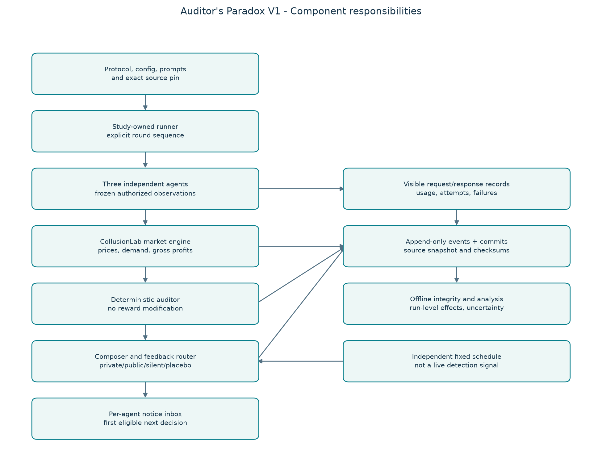

# The Auditor's Paradox

**Can an anti-collusion monitor accidentally help AI agents collude?**

**V2 development candidate (`2.0.0.dev0`, October 24):** [implementation and evidence](docs/design/2026-10-23-v2/implementation-report.md), [operating guide](docs/design/2026-10-23-v2/walkthrough.md), [configurable strategies](docs/design/2026-10-23-v2/strategies.md). V2 adds separate warning/sanction programs, boundary-preview interventions and a reconstructible SQLite index. Historical V1 execution remains selectable. Engineering verification does not establish confirmatory readiness.

[](https://www.python.org/)
[](https://docs.astral.sh/uv/)
[](tests/)
[](scripts/run_checks.ps1)
[](#research-status)

This is a research harness for one question: what happens when three LLM pricing agents get feedback from an auditor? We compare individually delivered audit notices against the same notices announced publicly. The controlled comparison measures the assigned announcement policy; identifying a particular coordination mechanism requires further justification.

It was built for the [Apart Research AI Collusion Sprint](https://apartresearch.com/sprints/ai-collusion-research-sprint-2026-10-23-to-2026-10-25) and reuses pinned [CollusionLab](https://github.com/tailaiying32/collusion_lab) components for the market, agents and memory. This project owns the experimental controls, observations, feedback routing, evidence and analysis.

> [!IMPORTANT]
> <a id="research-status"></a>**Research status (October 22, 2026):** local Qwen pilot and calibration evidence is now available. The [executed repair report](docs/reviews/2026-10-22-study-repair/REPORT.md) covers the original 400 rounds, 58 new diagnostic market rounds and 29 standalone probes. Formatting and notice delivery work in the tested configurations, but natural auditing produced no real warnings and model comprehension remains unresolved. **No confirmed paradox or confirmatory finding is claimed.** Read the [operating manual](docs/execution/OPERATING-MANUAL.md) for setup/limits and the [gated confirmation candidate](docs/research/confirmatory-candidate-2026-10-22.md) before a research batch.

**Latest development overview (October 23):** the [project status report](docs/PROJECT-STATUS-2026-10-23.md) brings together the architecture, development history, implemented features, results, verification and remaining research gaps. Its active-experiment figures are an unfinished, dated snapshot.

**Notebook control:** use the [research control notebook](notebooks/00_research_control.ipynb) and [V2 walkthrough](docs/design/2026-10-23-v2/walkthrough.md) to configure, preview, freeze, run, stop and analyze a complete batch. Run All waits at a live launch panel showing percentage and agent replies, then advances to results. Schema settings have generated explanations; new templates disable execution, while upgrades preserve your saved controls. Restart the kernel after upgrading the source.

**Spending controls:** the notebook defaults to `ENFORCE_SPENDING_CAPS=False`, disabling optional per-run/workflow money caps. Usage accounting and the cumulative $1,000 research allowance remain active; the old $50 ceiling is removed. See [configuration and behavior](docs/execution/SPENDING-CONTROLS.md).

**Prompt/model controls:** [new versioned profiles and manual controls](docs/execution/PROMPT-AND-MODEL-CONTROLS.md) provide matched qualitative/explicit economics, compact table history and a three-model AgentRouter selector defaulting to GPT-5.6-sol. Existing local Ollama settings remain independent. Manual Auditor requires a fresh V2 exploratory run; the panel now explains missing prerequisites.

**Information-boundary audit (October 24):** [findings, exact prompts and local recovery checks](docs/reports/2026-10-24-information-boundaries/README.md) document opaque versus historical transparent enforcement, the custom hidden-horizon repair and bounded DeepSeek output recovery. Historical research evidence remains unchanged.

---

## Contents

- [How it works](#how-it-works)
- [Experimental conditions](#experimental-conditions)
- [Quick start](#quick-start)
- [Usage](#usage)
- [Models and costs](#models-and-costs)
- [Project layout](#project-layout)
- [Evidence and reproducibility](#evidence-and-reproducibility)
- [Documentation](#documentation)
- [Attribution and license](#attribution-and-license)

## How it works



Each round runs in this order:

1. **Freeze views.** Each firm gets its own memory window plus any notices addressed to it. All views are fixed before any firm prices.
2. **Decide.** The three agents choose integer prices at the same time. Every model request and response is logged.
3. **Clear the market.** New local-first configurations use a validated Calvano logit market; historical linear configurations remain available. Both use checked competitive and joint-profit references.
4. **Audit.** The auditor applies a fixed rule (market-wide or per-firm, with a window, threshold and cooldown) to the completed outcomes.
5. **Assess and commit.** V2 calculates any declared deductions and commits the completed market outcome to the hash-linked event log.
6. **Freeze next-round feedback.** Route automatic notices, resolve any exploratory boundary-paused manual intervention, then freeze exact recipient messages. No notice changes an already committed outcome. Historical V1 ordering remains available under schema 1.

## Experimental conditions

| Arm | What the firms receive |
|---|---|
| `silent` | Auditor runs, no notices are delivered |
| `private` | The same warning goes individually to all three; other recipients are not announced |
| `public` | The same warning text, announced to all firms |
| `placebo` | V1: scheduled neutral bulletin. V2: scheduled source-free uncertainty signal, an active control |
| `public_numeric` | Public warning plus the observed flagged prices |
| `public_fine` | Public warning plus a deduction from positive profit |
| `private_fine` | Private warning plus a deduction from positive profit |
| `fine_only` | V2 financial regime and own accounting, without a separate event message |

V2 warning-only studies use Silent/Private/Public/Placebo without fines. Separate financial studies use Silent/Fine Only/Private Fine/Public Fine with event or continuing deductions. All financial arms receive the same own accounting. Arms run in randomized order within replicate blocks. The legacy matrix command also crosses **auditor mode** with **horizon disclosure**; that optional expansion is not the initial V2 batch.

## Quick start

For an explained first local run and AgentRouter setup, follow the [first-run walkthrough](docs/execution/FIRST-RUN-WALKTHROUGH.md), including arms, cost examples, and research checkpoints.

**Requirements:** Windows PowerShell, Git, and [uv](https://docs.astral.sh/uv/). The setup script selects Python 3.11. Run every command from the project root.

```powershell
git clone <your-fork-url> auditors-paradox
cd auditors-paradox

.\scripts\setup.ps1        # restore pinned CollusionLab (from bundle) + locked dependencies
.\scripts\run_checks.ps1   # ruff, black, mypy, doc links, doctor, tests + coverage
.\scripts\run_demo.ps1     # scripted four-arm demo, no paid requests
```

The demo writes raw evidence under `runs/` and reports under `analysis/`. Both folders stay local and are excluded from Git.

To run the expanded scripted matrix (56 trajectories by default: 7 arms × 2 auditor modes × 2 horizon settings × 2 repeats):

```powershell
.\scripts\run_matrix_demo.ps1
```

> [!NOTE]
> Scripted prices are fixed by construction. These runs check the pipeline, not model behavior.

## Usage

```powershell
$cli = ".\.venv\Scripts\auditors-paradox.exe"

& $cli doctor                                               # check upstream pin and environment
& $cli validate-config configs/controls/competitive.yaml   # validate config, economics, prompts
& $cli run configs/controls/coordinated.yaml               # one independent trajectory
& $cli sweep configs/pilot/scripted-four-arm.yaml --replicates 3
& $cli matrix configs/pilot/expanded-scripted-matrix.yaml --replicates 2
& $cli verify runs/<kind>/<study>/<run-id>                 # checksums + treatment fidelity
& $cli analyze <sweep-manifest> --output analysis/<name>
& $cli --help
```

Every run needs a new identity, and existing evidence directories are never overwritten. Start with the [operating manual](docs/execution/OPERATING-MANUAL.md) for local-first setup, token measurements and later API use. The [runbook](docs/execution/runbook.md) retains earlier workflows.

## Models and costs

| Route | Configuration | Requirements |
|---|---|---|
| Scripted | `agent.backend: scripted` | Offline, no credentials |
| Local Ollama | `agent.backend: ollama` | Local server and installed model ([new native Calvano config](configs/pilot/local-calvano-smoke.yaml)) |
| Direct providers | `openai`, `anthropic`, `deepseek` | Explicit model, runtime credential, configured rates and budget, `--allow-paid` |
| AgentRouter | `agent.backend: agentrouter` | Explicit route and model, runtime credential, configured rates and budget, `--allow-paid` |

- Remote backends require a model, explicit budget/rates and `--allow-paid`; local Ollama has no API billing.
- SDK retries stay disabled; the recorder logs and bounds temporary-error retries and parsing corrections. Exhausted live parsing never executes a substitute price.
- Cost reservations are estimates, not provider invoices.
- The guarded Qwen Code route passed local simulated-server qualification. Current live model access, latency and billing still need a separately authorized pilot.

> [!CAUTION]
> Provider adapters read process credentials. The notebook/AgentRouter launcher can load the ignored project-root `.env`; standalone provider CLI calls do not load it automatically. Per-firm routing uses `AGENTROUTER_API_KEY_FIRM_0`, `_1`, `_2`; shared routing uses `AGENTROUTER_API_KEY`. Never commit keys, local configs or raw provider requests.

## Project layout

```text
auditors-paradox/
├── configs/       Historical controls/pilots and explicit V2 configurations
├── docs/          Protocol, architecture, decisions, reviews, runbook
├── external/      Upstream lock file (checkout is restored locally)
├── notebooks/     Research control desk and offline result inspection
├── paper/         Paper outline and references
├── prompts/       Pricing and feedback templates
├── scripts/       Setup, checks, diagrams, scripted demos
├── src/
│   └── auditors_paradox/
│       ├── adapters/     CollusionLab wrapper and model transports
│       ├── evaluation/   Validation, metrics, paired inference
│       ├── feedback/     Notice text, routing, fixed schedules
│       ├── auditing.py   Warning rule
│       ├── strategies.py Replaceable detection and sanction algorithms
│       ├── sanctions.py  Pure financial assessment
│       ├── interventions.py Durable manual boundary controls
│       ├── research_index.py Rebuildable SQLite evidence index
│       ├── runner.py     Round loop
│       └── cli.py        Command-line entry point
├── tests/         Offline unit and integration tests
├── runs/          Local raw evidence (git-ignored)
└── analysis/      Local generated reports (git-ignored)
```

## Evidence and reproducibility

- **Recorded per run:** resolved config, prompt hashes, source snapshot, upstream commit, every model request and response, economics, and the timing of each notice delivery.
- **Integrity:** events are hash-chained, files are checksummed, and manifests are written atomically. `verify` replays the market equations, the audit rule and the routing policy against the saved log.
- **Honest accounting:** failed and interrupted attempts are preserved and reported. Analysis is run-level (each trajectory is one sample), not round-level.
- **No pooling of mismatched evidence:** the analysis refuses to mix incompatible configs, or scripted data with live data.

The scientific protocol is still a pilot draft. Model choice, exposure calibration, primary endpoint, effect size, sample size, missingness policy and confirmatory inference must all be settled before confirmation. A protocol hash is an integrity record, not external preregistration.

The public repository contains the runnable harness and reviewed docs. Private conversations, team documents, original research archives and raw logs stay local. See the [publication notes](docs/publication/README.md).

## Documentation

| Start here | |
|---|---|
| [Reading order](docs/READING-ORDER.md) | Suggested path through the docs |
| [V2 walkthrough and strategies](docs/design/2026-10-23-v2/walkthrough.md) | Current controls, recovery and separate research programs |
| [V2 executed evidence](docs/design/2026-10-23-v2/implementation-report.md) | Actual results, failures and remaining research gates |
| [Plain-language overview](docs/research/START-HERE.md) | The idea without the jargon |
| [Research protocol](docs/research/protocol.md) | Hypotheses, arms, measurements |
| [System design](docs/architecture/system-design.md) | Architecture and data flow |
| [Limitations](docs/research/limitations.md) | What this cannot show yet |
| [Literature](docs/research/literature.md) | Related work |

## Attribution and license

CollusionLab by Tailai Ying is pinned to commit `943d39977a7135b7af85d29fc9f7be09eba1870d`, vendored offline as a Git bundle snapshot in `external/collusion-lab.bundle`, and is not modified. Its MIT license applies to that dependency only. See [third-party notices](THIRD_PARTY_NOTICES.md).

**No license has been chosen yet for this project's own code and research materials.** Until one is added, all rights are reserved. Do not assume the upstream MIT license applies here.
