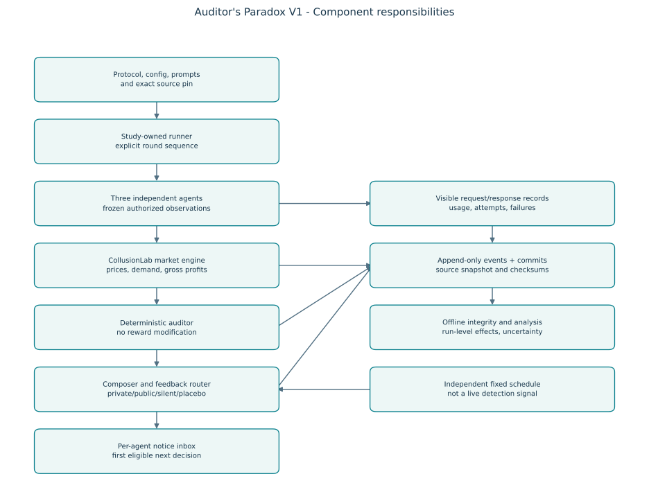

# V1 system design

**Reading note:** start with the [plain-language overview](../research/START-HERE.md). The original four-arm core described here now has the [owner-approved extension](../research/design-revisions/2026-10-16-owner-decisions.md): numeric warnings, fine arms, two auditor rules, and hidden/disclosed horizons. The core diagram shows component ownership; the new fine calculation belongs in the runner after observation-only auditing and before next-round memory.

## Current extension at a glance

| Part | Current behavior |
|---|---|
| Firms | Three independent histories and decisions; all observations frozen before any current price is chosen |
| Market | Historical linear model plus a validated Calvano logit grid with explicit price units in version 1.2 |
| Auditor | Select market-wide profit/spread rule or per-firm rolling-price rule; explicit cooldown |
| Notices | Silent, individual-to-all, broadcast, neutral placebo, numeric broadcast, public fine, private fine |
| Financial policy | Only fine arms deduct a configured fraction of flagged firms' positive gross profit; agents see own net earnings |
| Horizon | Hidden or disclosed final round; same actual configured run length |
| Matrix | Two auditor policies by two disclosure settings, separate cell evidence/analysis and a total paid ceiling |
| Model access | Scripted, direct providers, AgentRouter Chat/Messages, or one local Ollama server; transports require live validation before research claims |

Current round order: **freeze views → collect prices → clear market/gross profits → audit → calculate any fine/net profits → route next-round notices → update own memory and commit evidence.** The fine policy never changes price choices or the auditor's gross inputs. The router only delivers text.

The remaining sections document the original core and the design principles it retains. Their no-enforcement requirements apply to the no-fine arms. See the [protocol extension](../research/protocol.md) for the exact alternative rules.

Status: **Implemented V1**, October 16, 2026. Accepted for implementation by the user. The operational research protocol remains a pilot draft; the engineering release contains no live-model result.

The product of this project is a defensible experiment and its evidence. The
runtime should make a small number of interventions easy to verify. Use a
modular Python application, component adapters, deterministic treatment
policies, and an explicit synchronous round pipeline.

## Requirements

Functional: three independent pricing agents; no direct agent chat; one fixed
market; deterministic observation-only auditing; silent, individually delivered,
public, and neutral-bulletin conditions; feedback from round t first available
in round t+1; frozen prompts and economic rules; independent replicate runs;
offline reconstruction of visible prompts and outcomes; run-level inference.

Nonfunctional: reproducible scripted checks, pinned dependency and source
versions, bounded model calls and spending, local execution, clear failure
states, immutable completed evidence, recipient isolation, no credentials in
logs, and a documented separation of smoke, pilot, and confirmatory work.

## Component architecture



[Editable Mermaid](diagrams/01_system.mmd); [canonical graph definitions](diagrams/definitions.json).

The neutral-bulletin schedule has its own input to the router. It does not
branch from the current audit flag. The evidence path is not an input to agent
prompts. The study runner does not invoke upstream automatic auditor feedback,
penalty notices, or periodic rival-reward summaries.

## Responsibilities and reusable components

| Component | Responsibility | CollusionLab relationship |
|---|---|---|
| Study config | Validate arm, schedule, model, observation policy, sample plan, and paths | Separate schema; translate a supported subset into upstream constructors |
| Market adapter | Construct and step one pricing environment; expose calibrated economics | Reuse `PricingConfig`, `PricingGame`, and demand models |
| Agent adapter | Construct independent agents and map authorized memory fields | Reuse public `LLMAgent`/`AgentMemory` APIs after contract checks |
| Observation policy | Public price history, own outcomes, own notes, authorized inbox only | Replace the upstream runner's unconditional feedback/report assembly |
| Auditor | Read completed behavior, update its history on every round, output evidence | Adapt `BehaviorAuditor` or implement a documented deterministic rule |
| Composer | Map a flag/event to a standardized warning body | Study-owned pure function; no LLM needed |
| Router | Audience, exact visibility wrapper, timing, and no-delivery outcomes | Study-owned policy; never changes prices or rewards |
| Model-call recorder | Visible messages, output, usage, timing, errors, retries | Wrap the upstream client; internal HTTP retries need additional instrumentation |
| Evidence writer | Canonical events, round commits, config and prompt snapshots, completion | Own JSONL writer; upstream DB `RunStore` is optional, not the flat-file writer |
| Evaluation | Validate fidelity and compute predeclared run-level outcomes | Reuse audited formulas where appropriate; do not adopt detector labels as truth |

Do not call upstream private helper methods as the adapter's production API.
The source-audit probe subclasses one private helper solely to inspect the
unmodified runner; that is diagnostic code, not the proposed integration.

## Design patterns

| Pattern | Use here | Limit |
|---|---|---|
| Modular application | Runtime, feedback, integration, evidence, evaluation have clear responsibilities | All can stay in one package/process |
| Adapter / ports and adapters | Convert upstream component types to the study's few contracts | No abstract interface for every small function |
| Strategy | Select a feedback policy and independent schedule by configuration | Simple functions or a small dispatch map are enough |
| Functional core, imperative shell | Pure warning/routing/metric calculations; explicit I/O and calls in runner | Stateful auditor history stays owned by one run |
| Decorator | Record visible model calls around a backend | An outer decorator cannot see retries hidden inside an SDK/backend |
| Immutable records | `CompletedRound`, `AuditEvent`, `Delivery`, `ModelCall` | Prefer dataclasses/typed schemas; avoid passing mutable global dicts |
| Dependency injection | Pass market, agents, auditor, router, and writer into the runner | Constructor/function arguments suffice; no DI framework |

An Observer event bus is a poor fit for the critical path: concealed callback
ordering would make the t/t+1 guarantee harder to audit. Append-only records are
useful evidence; a full CQRS/event-sourcing platform is unnecessary.

## Minimal record contracts

These are implemented record responsibilities. Exact serialized names are defined by the event writer and validator. The source tree hash and saved source ZIP identify study code; the upstream commit identifies reused components.

| Record | Essential fields |
|---|---|
| Study/run identity | `schema_version`, `study_id`, `protocol_hash`, `run_id`, `run_kind`, `arm`, `replicate_id`, `assignment_block` |
| CompletedRound | `round`, prices, quantities, `gross_rewards`, `net_rewards`; linked decision/call events |
| AuditEvent | `event_id`, `source_round`, `rule_version`, score, threshold, flag, evidence including window |
| Delivery | `delivery_id`, `source_id` (audit or schedule), recipient, arm, exact body/header/text, `source_round`, `effective_round`, status |
| ModelCall | call ID, agent, decision round, visible messages or content-addressed snapshot, response, parsed action, usage, error, retry/fallback provenance |
| Run manifest | study source tree hash and source ZIP, upstream SHA, resolved config, prompt hashes, model metadata, schedule hash, completed rounds, status, evidence checksums |

For every arm, record a routing decision even when no message is delivered. Do
not insert that no-delivery decision or a “not audited” sentence into the
agent's prompt. Distinguish `not_scheduled`, `not_flagged`, `suppressed_by_arm`,
`scheduled_for_next_round`, and `consumed_by_decision`. A message after the final
round has no next decision to influence; do not count it as consumed.

Store returned explanations as model text, without treating them as faithful
internal states. A model-call log means the visible API request/response, not
access to hidden reasoning or activations.

## Exact execution order

1. Resolve and validate config, source pin, prompt files, market benchmarks,
   run class, schedule, output uniqueness, and budget before creating any paid
   client call. Write a `running` manifest with UTC timestamps.
2. Freeze every agent's round-t view from state through t-1 and inbox entries
   with `effective_round == t`. Snapshot the exact visible request.
3. Collect all actions from those frozen views. Sequential API calls are
   acceptable if later agents cannot see earlier current-round decisions.
4. Step the market exactly once using the whole action vector. Save gross and
   net rewards; require equality in V1.
5. Update the auditor's history from the completed round. If audit sampling is
   supported later, sampling delivery/evaluation must not accidentally make a
   “consecutive-round” window mean “consecutive sampled audits.”
6. Compose warning substance and calculate arm-specific deliveries. Resolve
   the independent placebo schedule without consulting current audit flags.
7. Persist round, audit, routing, calls, and a completed-round record. Stage
   authorized inbox items for t+1. Keep observers/analysis out of the prompt path.
8. On completion, verify round counts, referential integrity, treatment rules,
   and checksums before marking the run complete. Atomically update the manifest.

## Information policy and causal interpretation

Start with the same public price history, own reward/share, horizon, memory
window, and prior awareness wording in every arm. The auditor may use privileged
market data; the protocol must list which facts its warning reveals. Disable
the upstream all-firm cumulative-reward report. Never expose the full store or
another agent's private memory to a pricing agent.

C1 and C2 receive the same warning body. C2 additionally states that it is
broadcast; C1 does not announce other recipients. This is an operational
disclosure manipulation, not proof that an LLM has acquired formal common
knowledge. Agents may infer other recipients from a deterministic rule and
public prices. Describe the contrast honestly as **announced common receipt
versus individually delivered receipt** until stronger belief evidence exists.

The live-monitor comparison estimates the total effect of the assigned feedback
policy, including its influence on subsequent warning incidence. Do not require
identical audit-event sequences after trajectories diverge. A fixed-schedule
diagnostic can isolate delivery more narrowly, but its warning content must be
truthful and independent of treatment-generated current behavior. Use a
predeclared replayed external signal or neutral bulletin, with that provenance
explicitly described. Do not claim those fixed signals are live detections.

C3 versus C2 mixes warning information, valence, timing, and possible frequency
differences unless those are controlled. A single neutral placebo arm does not
identify every proposed mechanism. If resources permit, compare shared and
independently jittered neutral signals as a separate diagnostic. Do not expand
the primary design before the main comparison is viable.

## Evidence storage and failure handling

Recommended run layout:

```text
runs/<smoke|pilot|confirmatory>/<study_id>/<run_id>/
    manifest.json
    resolved-config.json
    source.zip            # exact code, prompt, protocol and dependency snapshots
    events.jsonl          # canonical rounds, audits, deliveries, inline calls and commits
    checksums.json        # finalized evidence hashes
```

One canonical event stream with derived views avoids contradictory copies of
round, audit, and delivery files. A completed-round event identifies the records
included in that round. A crash may leave an incomplete tail; preserve it and
mark the run failed or interrupted. Do not truncate previous complete rounds
to make a run look successful. A reused run ID must fail before file opening.

Exactly-once external API execution cannot be guaranteed by a local log after a
crash. V1 should restart failed trajectories under a new attempt ID unless a
tested checkpoint contains environment state, all memories, auditor window,
pending deliveries, RNG states, and completed-call provenance. Retain failed
attempts and prespecify their analysis disposition.

Missing provider prices mean unknown estimated cost, not zero cost. Bound
retries, log parse corrections and fallback actions, and stop when the reserved
budget cannot safely cover another call. Provider-specific retry/usage capture
must be validated before using billing totals as exact observations. Keep
credentials runtime-only and redact them from resolved configuration exports.

## Acceptance checks before real experiments

| Gate | Required evidence |
|---|---|
| Adapter | Three agents, valid integer prices, correct quantities/rewards, stable imports at pinned SHA |
| Economics | Best response at the competitive reference; joint benchmark valid on the actual action grid |
| No enforcement | Identical scripted rewards with auditor on/off; no sanction language or labels in prompts |
| Recipient isolation | Inspect exact agent prompts, including periodic and memory paths |
| Timing | Flag at t absent from every round-t request and present only for authorized t+1 recipients |
| Silent arm | No audit-derived text anywhere in visible prompts |
| Public/private | Matched body hashes, specified headers, correct recipients, actual consumption records |
| Placebo | Schedule fixed and hashed before the run; independent of current-run detections |
| Persistence | No overwrite; explicit interrupted/failed/complete status; valid committed round chain |
| Statistics | Frozen primary metric, analysis window, independent run count, randomization, and failure policy |
| Live-model pilot | Acceptable parsing and strategic behavior; observed tokens, latency, usage, and budget |

Upstream unit tests and fixed-price scripted controls establish engineering
properties. They cannot establish that LLM coordination emerges or that public
warnings cause it. Those require separate model pilots and randomized trials.

## V1 implementation details

Notices enter the explicit next-decision inbox; historical market records contain no audit feedback. Own returned notes remain bounded. See [ADR-003](decisions/0003-notice-retention-and-provider-attempts.md). The exhaustive benchmark check covers every unordered three-firm price-grid profile. Batches execute serially in randomized replicate blocks. SDK transport retries are disabled. No root Git history was invented; study source snapshots provide code identity.

Canonical diagram definitions generate both Mermaid and SVG/PNG through `scripts/render_diagrams.py`:


[Editable Mermaid](diagrams/01_system.mmd) - [round pipeline](diagrams/02_round_pipeline.mmd) - [phases](diagrams/03_v1_phases.mmd).
